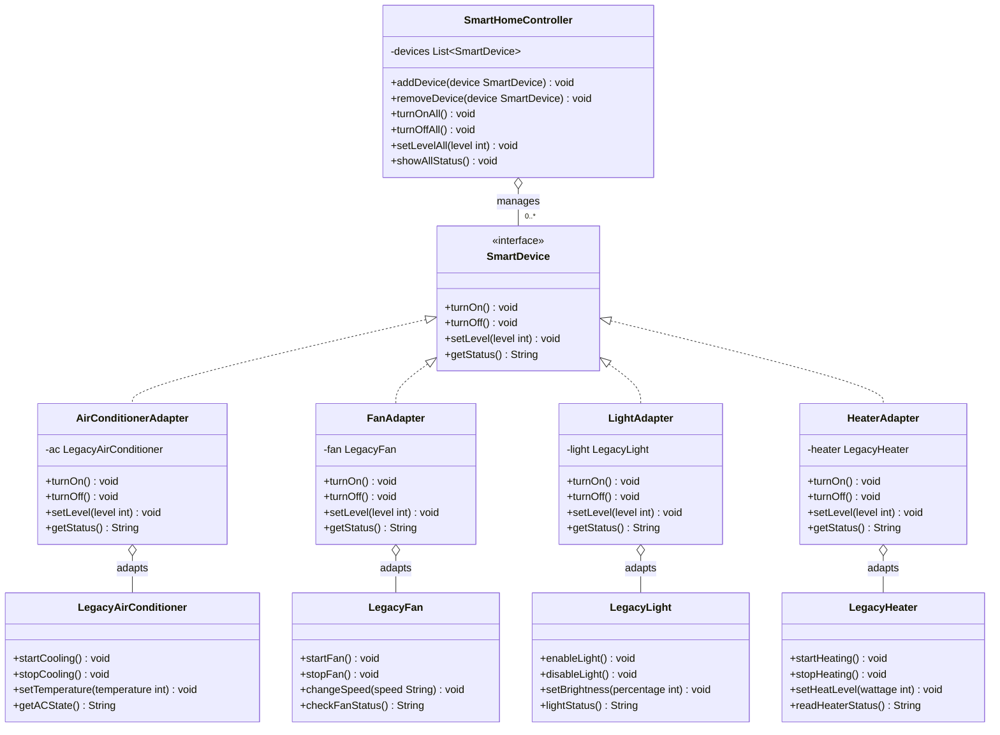
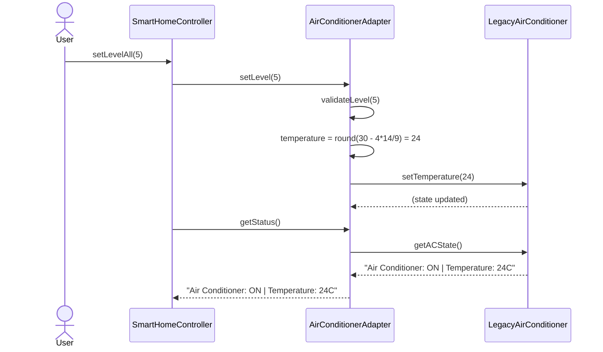

# 3. Real-World Case Study and Implementation

## 3.1 Problem Description

Modern residential environments increasingly combine devices acquired at
different times, from different manufacturers, each exposing its own
proprietary control interface. In the case study considered here, a
smart home application must manage four such devices: an air
conditioner, a fan, a light, and a heater. Each device is represented by
a *legacy* class — `LegacyAirConditioner`, `LegacyFan`, `LegacyLight`,
and `LegacyHeater` — that was designed independently of the others and,
critically, independently of the smart home application itself. These
classes therefore differ along three dimensions:

1. **Method naming.** Turning a device on is expressed as
   `startCooling()`, `startFan()`, `enableLight()`, or
   `startHeating()`, depending on the class.
2. **Intensity representation.** Each device encodes its operating
   intensity using a different unit and range: the air conditioner uses
   a temperature in degrees Celsius (16–30), the fan uses a discrete
   string value (`LOW`, `MEDIUM`, `HIGH`), the light uses a brightness
   percentage (0–100), and the heater uses a wattage value (100–1000).
3. **Status reporting.** Each class exposes a differently named method
   (`getACState()`, `checkFanStatus()`, `lightStatus()`,
   `readHeaterStatus()`) that returns a status string in its own format.

The central engineering constraint is that these legacy classes
**cannot be modified**. This reflects a common real-world situation in
which device drivers are supplied by third-party vendors, distributed as
compiled libraries, or shared with other systems that already depend on
their existing interfaces. Any design that required editing these
classes — for instance, making them implement a common interface
directly — would not be viable in practice and would defeat the purpose
of treating them as pre-existing, closed components.

The application-level requirement is that a single controller,
`SmartHomeController`, be able to manage an arbitrary collection of
devices uniformly: turning them all on or off, setting a common
intensity level, and reporting status, without embedding
device-specific conditional logic (e.g., a chain of `instanceof` checks)
within the controller itself. Furthermore, the design should allow new
device types to be introduced later without modifying the controller's
source code.

## 3.2 Justification for the Adapter Pattern

The **Adapter Pattern** (Gamma et al., 1994) is the appropriate solution
to this problem because it is defined precisely for the scenario
described above: converting the interface of an existing class into
another interface that clients expect, without altering the existing
class, so that classes with incompatible interfaces can collaborate.

Three properties of the Adapter Pattern map directly onto the
requirements of this case study:

- **Interface translation without source modification.** The pattern
  introduces a new, intermediary class — the adapter — that implements
  the interface the client expects and internally delegates to the
  existing (adaptee) object. This satisfies the constraint that the
  legacy device classes remain untouched.
- **Decoupling the client from concrete implementations.** Because the
  client depends only on the target interface, it has no compile-time
  or run-time knowledge of the adaptee classes. This directly satisfies
  the requirement that `SmartHomeController` avoid device-specific
  branching logic.
- **Open/closed extensibility.** Introducing a new legacy device
  requires only writing one new adapter class; neither the target
  interface nor the client needs to change. This satisfies the
  requirement that the system be extensible to future device types.

Alternative patterns were considered and rejected for this problem.
The **Facade** pattern simplifies a complex subsystem behind a single
interface, but it does not address the core issue here, which is
interface *incompatibility* between several independent classes, not
subsystem complexity. The **Bridge** pattern separates an abstraction
from its implementation so that both can vary independently, but it is
intended to be designed in from the start for classes under the
designer's control, whereas the legacy classes here are fixed,
pre-existing, and not under the designer's control. The Adapter Pattern
is the only one of the three whose defining intent — reconciling a
mismatch between an existing interface and a required interface — matches
the stated problem exactly.

## 3.3 Mapping of Pattern Roles to the Case Study

The general Adapter Pattern defines four participants: *Target*,
*Client*, *Adapter*, and *Adaptee*. Each is realized in the case study
as follows.

| Pattern Role | Case Study Class | Responsibility |
|---|---|---|
| **Target** | `SmartDevice` | Declares the uniform interface (`turnOn`, `turnOff`, `setLevel`, `getStatus`) that the client is written against. |
| **Client** | `SmartHomeController` | Operates exclusively on `SmartDevice` references; is unaware of any adaptee or adapter type. |
| **Adapter** | `AirConditionerAdapter`, `FanAdapter`, `LightAdapter`, `HeaterAdapter` | Each implements `SmartDevice` and wraps exactly one adaptee instance, translating both method calls and intensity values. |
| **Adaptee** | `LegacyAirConditioner`, `LegacyFan`, `LegacyLight`, `LegacyHeater` | Pre-existing classes with incompatible interfaces; unmodified by the solution. |

This mapping follows the **object adapter** variant of the pattern (as
opposed to the class adapter variant, which relies on multiple
inheritance). Each adapter holds a private reference to its adaptee and
is composed with it at construction time, which is the natural choice
in Java, since the language does not support multiple class
inheritance.

## 3.4 Case-Study UML Class Diagram



The diagram shows the four adapters realizing the `SmartDevice`
interface while independently composing one adaptee each. No
inheritance or dependency relationship exists between the legacy
classes and `SmartDevice`, which is the structural property that proves
the legacy code remains unmodified.

## 3.5 Java Implementation

The solution was implemented in Java 17 and organized into three
packages: the root `smarthome` package (target interface and client),
`smarthome.adapter` (the four adapters), and `smarthome.legacy` (the
four adaptees). The target interface is defined as follows:

```java
public interface SmartDevice {
    void turnOn();
    void turnOff();
    void setLevel(int level);   // unified scale: 1 (lowest) .. 10 (highest)
    String getStatus();
}
```

Each adapter follows the same structural template: implement
`SmartDevice`, store a reference to the adaptee, delegate `turnOn`/
`turnOff` directly, and perform a unit conversion inside `setLevel`.
The `AirConditionerAdapter` illustrates this most clearly, since it must
convert a unit-less integer scale into a physical temperature:

```java
public class AirConditionerAdapter implements SmartDevice {
    private final LegacyAirConditioner ac;

    public AirConditionerAdapter(LegacyAirConditioner ac) {
        this.ac = ac;
    }

    @Override
    public void turnOn() {
        ac.startCooling();
    }

    @Override
    public void setLevel(int level) {
        validateLevel(level);
        int temperature = (int) Math.round(30 - (level - 1) * (14.0 / 9.0));
        ac.setTemperature(temperature);
    }

    @Override
    public String getStatus() {
        return ac.getACState();
    }

    private void validateLevel(int level) {
        if (level < 1 || level > 10) {
            throw new IllegalArgumentException("Level must be between 1 and 10, got: " + level);
        }
    }
}
```

The client, `SmartHomeController`, depends solely on the `SmartDevice`
type:

```java
public class SmartHomeController {
    private final List<SmartDevice> devices = new ArrayList<>();

    public void addDevice(SmartDevice device) {
        devices.add(device);
    }

    public void turnOnAll() {
        for (SmartDevice device : devices) {
            device.turnOn();
        }
    }

    public void setLevelAll(int level) {
        for (SmartDevice device : devices) {
            device.setLevel(level);
        }
    }
}
```

## 3.6 Explanation of the Important Implementation Details

Three aspects of the implementation merit particular attention.

**First, validation is located in the adapter, not the adaptee or the
client.** The constraint "level must be between 1 and 10" belongs to the
application's own contract, defined by the `SmartDevice` interface; it
is not a property of any legacy device. Each legacy class independently
validates its own native range (for example, `LegacyAirConditioner`
rejects temperatures outside 16–30). Placing the 1–10 check in the
adapter keeps each validation rule at the layer that owns it and
prevents the client from needing to know either range.

**Second, each conversion formula is derived to preserve the semantic
direction of "intensity."** For the air conditioner, a higher
application level must correspond to *stronger cooling*, i.e. a *lower*
temperature; the formula `30 - (level - 1) * 14/9` therefore decreases
as `level` increases, mapping level 1 to 30°C and level 10 to 16°C. For
the fan, light, and heater, higher levels map to higher native values
(`HIGH`, higher percentage, higher wattage respectively), since those
devices' native scales already increase with intensity. This detail is
important because a naive, purely linear mapping applied uniformly to
all four devices would have produced an inverted, incorrect behavior for
the air conditioner.

**Third, the adapters are composed with their adaptees through
constructor injection** (`new AirConditionerAdapter(legacyAC)`) rather
than having each adapter construct its own adaptee internally. This
follows the Dependency Inversion principle and makes the adapters
straightforward to unit test in isolation, since a test can construct a
`LegacyAirConditioner`, wrap it, and assert on both the adapter's
returned status and the adaptee's internal state after a call.

## 3.7 Collaboration Between the Classes

The sequence below demonstrates how a single client request —
`controller.setLevel(5)` issued against the air-conditioner device —
is resolved through collaboration between the client, the adapter, and
the adaptee:



This trace shows the essential property of the pattern in operation:
the controller issues exactly one call, `setLevel(5)`, with no awareness
that the number `5` is subsequently transformed into the value `24` in
an entirely different unit, nor that the call is ultimately satisfied by
`LegacyAirConditioner.setTemperature(int)`. The same collaboration
structure is repeated, with a different conversion computed inside the
adapter, for the fan, light, and heater devices, which confirms that the
controller's logic generalizes uniformly across all four adaptees
without modification.

---

# 4. Advantages, Disadvantages, and Design Trade-offs

## 4.1 Advantages

**Flexibility and extensibility.** New device types can be integrated
by adding a single new adapter class that implements `SmartDevice`. No
existing class — the target interface, the client, or any other
adapter — requires modification. This satisfies the Open/Closed
Principle: the system is open to extension but closed to modification.

**Low coupling between client and adaptees.** `SmartHomeController`
has no compile-time dependency on any `Legacy*` class. This isolates
the controller from changes to legacy APIs: if a legacy vendor revises
`LegacyFan.changeSpeed(String)` to accept an enumerated type instead of
a string, only `FanAdapter` needs to change.

**Reuse of existing, unmodified code.** The pattern allows the legacy
classes to be reused as-is, which is valuable when those classes are
externally maintained, already in production use elsewhere, or
otherwise outside the team's control.

**Improved testability.** Because adapters depend on their adaptee
through an injected reference rather than an internally constructed
one, each adapter can be unit-tested independently by supplying a
real or substitute adaptee instance and asserting on the resulting
translated calls, without requiring the controller or other adapters to
be present.

## 4.2 Disadvantages

**Increased number of classes.** Each adapted device requires an
additional class whose sole purpose is translation. For a system with
many device types, this results in a proportional growth in the
codebase, which is a recognized cost of the pattern.

**Indirection overhead.** Every operation on an adapted device passes
through an additional method call before reaching the adaptee. While
negligible in terms of runtime performance for this case study, the
extra layer can make it harder for a new reader to trace behavior
end-to-end without first understanding that an adapter is present.

**Risk of lossy or approximate conversion.** Mapping a continuous or
fine-grained scale onto a coarser one, as in the fan's three-value
`LOW`/`MEDIUM`/`HIGH` scale, necessarily discards information — levels
1, 2, and 3 are indistinguishable once translated. This is an inherent
consequence of adapting between representations of different
granularity, and must be accepted (or explicitly documented, as done in
this implementation) rather than treated as a defect of the pattern
itself.

**Does not resolve behavioral, only structural, incompatibility.** The
Adapter Pattern reconciles differences in interface signatures and data
representation, but it cannot compensate for adaptees with fundamentally
different behavioral guarantees (for example, an adaptee that is
asynchronous where the target interface assumes synchronous calls). No
such mismatch exists in this case study, but it is a known limitation of
the pattern in general.

## 4.3 Design Trade-offs

| Dimension | Effect of Using the Adapter Pattern |
|---|---|
| **Flexibility** | Increased. The client can operate on any current or future device type uniformly, as long as an adapter exists for it. |
| **Maintainability** | Improved locally: each conversion rule is isolated in one class, so a change to one device's conversion logic cannot affect another's. Slightly reduced globally: a developer must consult the adapter to understand what a given client call actually does to the hardware, rather than reading it directly in the client. |
| **Extensibility** | Improved. Adding a device type is an additive change (one new class), not a modification to existing, already-tested code. |
| **Complexity** | Increased at the structural level (more classes, one extra indirection per call) but decreased at the client level (no conditional branching on device type). The overall complexity is redistributed rather than eliminated. |
| **Coupling** | Reduced between client and adaptees (the controller depends only on the target interface). Coupling is preserved, by necessity, between each adapter and its specific adaptee, since an adapter's entire purpose is to know how to drive one particular legacy class. |
| **Testability** | Improved. The target interface can be mocked or stubbed to test the controller in isolation, and each adapter can be tested against its real adaptee in isolation, without needing the full system assembled. |

## 4.4 Alternative Design

A reasonable alternative worth noting is to forgo adapters entirely and
instead require every device class to implement `SmartDevice` directly,
modifying `LegacyAirConditioner`, `LegacyFan`, `LegacyLight`, and
`LegacyHeater` so that their own methods are renamed and their own
`setLevel` performs the unit conversion internally. This would eliminate
the extra adapter classes and the one layer of indirection, at the cost
of violating the stated constraint that legacy classes must remain
unmodified; in a realistic deployment, it would require vendor
cooperation, break any other system already depending on the original
legacy interface, and need to be repeated for every future device
vendor. Given that constraint, the Adapter Pattern remains the more
appropriate choice for this case study, trading a modest increase in
class count for the ability to integrate unmodifiable third-party code
safely.

---

## References

Gamma, E., Helm, R., Johnson, R., & Vlissides, J. (1994). *Design
Patterns: Elements of Reusable Object-Oriented Software*.
Addison-Wesley.
